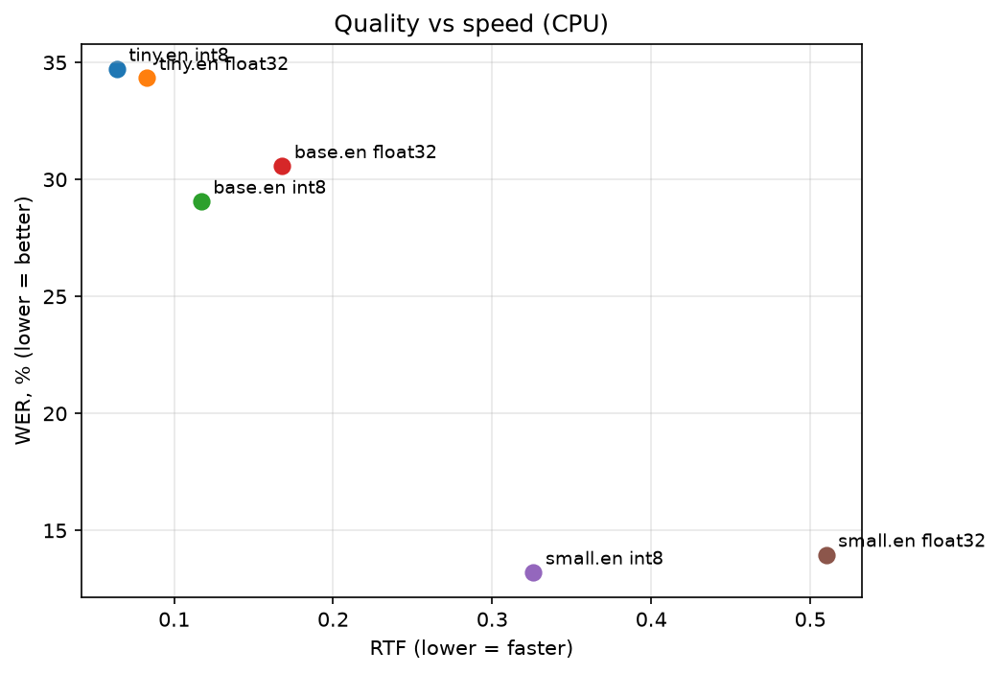

# Voice Overlay

A lightweight desktop dictation tool for Windows. Press a hotkey, speak, press it again, and the transcribed text is pasted into whatever window has your cursor. Speech recognition runs **fully locally** with faster-whisper, so no audio leaves your machine.

<!-- TODO: add a short GIF of the overlay in action -->

## Features

- **Global hotkey** (Right Alt by default) that works in any application
- **Toggle mode** (press to start, press to stop) or **push-to-talk** (hold to record)
- **Always-on-top overlay** that never steals focus: shows loading, listening (with a live level meter), and transcribing states
- **Local ASR** with faster-whisper, int8 quantization, and VAD filtering to cut silence and reduce hallucinations
- **Clipboard-safe pasting**: the text is pasted with Ctrl+V and your previous clipboard content is restored afterwards
- Runs from the system tray, no main window

## How it works

```
hotkey ──► Recorder (sounddevice, 16 kHz mono)
                │
                ▼
          Transcriber (faster-whisper, background thread)
                │
                ▼
          TextInjector (clipboard + Ctrl+V into the active window)

Overlay (PySide6) shows the current state throughout.
```

Background threads (keyboard listener, audio callback, model inference) talk to the Qt main thread through queued signals, which keeps the UI responsive and thread-safe.

## Project structure

```
voice-overlay/
├── main.py                  # entry point: tray icon, wiring
├── requirements.txt
├── start_voice_overlay.bat  # launcher without a console window
├── app/
│   ├── config.py            # hotkey, model, language, mode
│   ├── controller.py        # glues hotkey, recorder, transcriber, injector
│   ├── hotkey.py            # global hotkey listener (hold / toggle)
│   ├── recorder.py          # microphone capture + level meter
│   ├── transcriber.py       # faster-whisper wrapper
│   ├── injector.py          # pastes text into the active window
│   └── overlay.py           # floating status pill
└── benchmark/
    ├── record_dataset.py    # record your own evaluation set
    ├── phrases.txt          # phrases to read aloud
    ├── benchmark.ipynb      # WER / RTF experiment
    ├── results.csv
    └── quality_vs_speed.png
```

## Installation

Requirements: **Windows 10/11, Python 3.12** (64-bit), a microphone.

> Python 3.13+ is not supported yet: `ctranslate2` does not ship wheels for it.

```
git clone <your-repo-url>
cd voice-overlay
py -3.12 -m venv .venv
.venv\Scripts\activate
python -m pip install -r requirements.txt
python main.py
```

On the first run the selected Whisper model is downloaded from Hugging Face (around 780 MB) and cached.

If PowerShell refuses to activate the environment,  call the interpreter directly: `.venv\Scripts\python.exe main.py`.

## Usage

1. Start the app. A pill appears at the bottom of the screen: *Loading model…* then *Ready*.
2. Put the cursor in any text field.
3. Press **Right Alt**, speak, press **Right Alt** again.
4. The text is pasted after a moment.

Exit via the tray icon → **Quit**.

### Run without an IDE

Double-click `start_voice_overlay.bat`: it starts the app via `pythonw.exe` with no console window and writes errors to `voice-overlay.log`. To start with Windows, put a shortcut to the `.bat` into the folder opened by `Win+R` → `shell:startup`.

### Configuration

Edit `app/config.py`:

| Option | Default | Meaning |
|---|---|---|
| `hotkeys` | Right Alt (`alt_r`, `alt_gr`) | Key(s) that trigger recording |
| `toggle_mode` | `True` | `True`: press to start/stop. `False`: hold to record |
| `model_name` | `small.en` | Whisper model loaded at startup |
| `language` | `en` | Recognition language |

## Benchmark

To choose the default model I measured quality and speed of several faster-whisper configurations on my own recordings.

**Setup**

- Dataset: 35 English phrases (~2 min) recorded by me on a laptop microphone: everyday speech, technical vocabulary, numbers, and a few deliberately hard phrases
- Hardware: CPU Amd Ryzen 7 8840U, 16 logical cores, GPU AMD Radeon 780M(Integrated, not used: CPU-only inference)
- Software: faster-whisper 1.2.1, ctranslate2 4.8.3, Python 3.12
- Decoding: `beam_size=5`, `vad_filter=True`, `condition_on_previous_text=False`
- Metrics: **WER** (word error rate, via [jiwer](https://github.com/jitsi/jiwer)) and **RTF** (real-time factor = processing time / audio duration; lower is faster)
- `WER_raw` compares lowercase text without punctuation. `WER_norm` additionally expands contractions (*we're* → *we are*) and spells out numerals (*5* → *five*), so formatting differences are not counted as recognition errors.

**Results**

| Model    | Compute | WER_raw, % | WER_norm, % | RTF   | Avg latency, s |
| -------- | ------- | ---------- | ----------- | ----- | -------------- |
| tiny.en  | int8    | 39.45      | 34.72       | 0.059 | 0.23           |
| tiny.en  | float32 | 38.67      | 34.34       | 0.079 | 0.30           |
| base.en  | int8    | 33.98      | 29.06       | 0.117 | 0.45           |
| base.en  | float32 | 35.94      | 30.57       | 0.165 | 0.63           |
| small.en | int8    | 18.36      | 13.21       | 0.321 | 1.23           |
| small.en | float32 | 18.75      | 13.96       | 0.507 | 1.94           |



**Takeaways**

- **int8 quantization costs no measurable accuracy** (WER differs by 0.4-1.5 p.p. in both directions, within noise for this dataset size) while being 1.3-1.6× faster than float32.
- **Quality scales unevenly with model size**: base.en improves on tiny.en by only ~6 p.p. WER, whereas small.en cuts WER by another ~16 p.p. (34.7% → 13.2%).
- **small.en (int8)** runs about *3× faster* than real time on CPU (RTF 0.32, ~1.2 s average latency per phrase) and has *less than half* the WER of base.en, so it is the only model shipped in the app.

**Error analysis**

- Everyday phrases are recognized well; most errors fall on technical terms and names (*SQL* → "stql", *GitHub* → "give up", *backend* → "back end", *Mike* → "mic").
- Some errors change the meaning (*call* → "code", *ten* → "town", *leaves* → "lives"), which matters for dictation.
- A few errors come from unclear diction of the speaker (me), not the model.

**Limitations**

- Small dataset (35 phrases), a single speaker, one laptop microphone, CPU only. Treat the **relative** comparison between configurations as the result, not the absolute WER values.
- Speed numbers depend on the hardware listed above.

**Reproduce**

```
python benchmark/record_dataset.py      # record the phrases from phrases.txt
# then run benchmark/benchmark.ipynb from top to bottom
```

The recordings themselves are not included in the repository.

## Known limitations

- Windows only (macOS and Linux X11 may work with extra permissions; Wayland is not supported)
- If the target window runs as administrator, run the app as administrator too, otherwise pasting is blocked
- Right Alt acts as AltGr on some layouts (e.g. Polish), so you may want a different hotkey in `config.py`
- English only for now

## Roadmap

- [ ] Custom vocabulary via `initial_prompt` to fix technical terms (measured on the benchmark)
- [ ] Text post-processing: filler-word removal, punctuation and casing, modes
- [ ] Streaming transcription with VAD
- [ ] Settings window and `config.json`
- [ ] Multilingual support

## Tech stack

Python 3.12 · PySide6 · faster-whisper (CTranslate2) · sounddevice · pynput · pyperclip · jiwer

## License

<!-- TODO: choose a license, e.g. MIT -->
